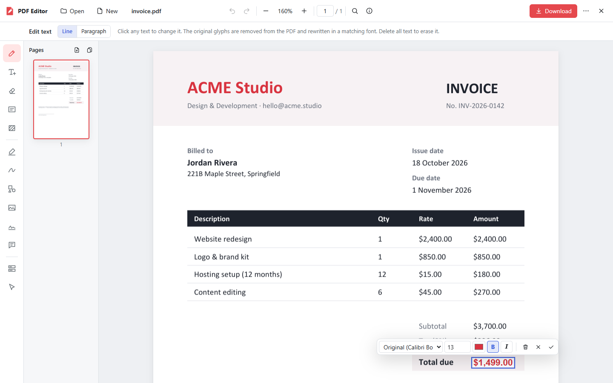
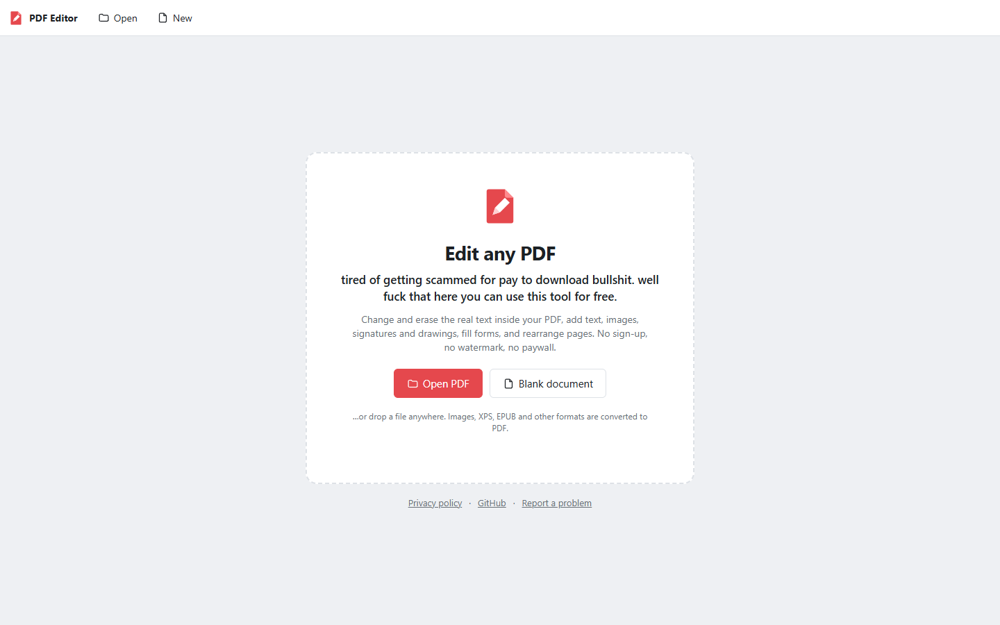
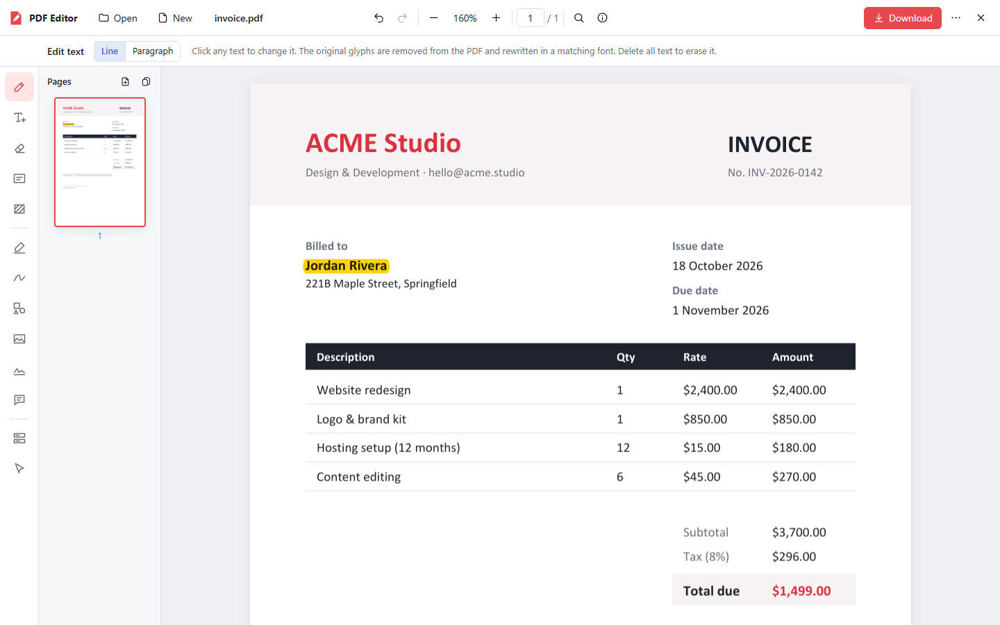
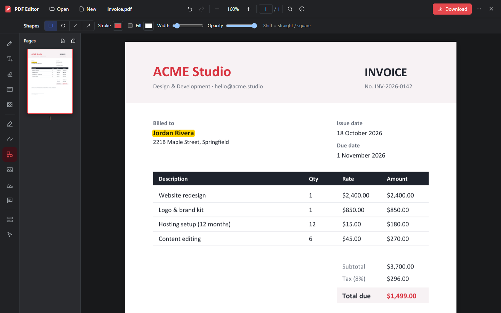

<div align="center">


# FREE PDF EDITOR

### Edit the *actual text* inside any PDF. In your browser. For free. Forever.

> **tired of getting scammed for pay to download bullshit. well fuck that here you can use this tool for free.**

<a href="https://free-pdf-editor-waj8.onrender.com">
  
</a>

<br><br>


<br>



<sub>☝️ That's a real PDF being edited. Click the text, type, done. Same font, same size, same colour.</sub>

</div>

---

## 💀 The problem

You've been here before:

1. You google "free PDF editor".
2. You upload your file, make your edits, and feel good about life.
3. You click **Download** and…
4. 💸 *"Upgrade to Pro to download your file!"* 💸
5. Or there's a giant watermark. Or "you've used your 2 free tasks today". Or you have to make an account and then get spammed forever.

**Nah. Not here.**

## ✨ The solution

Open the link. Drop your PDF. Edit it. Download it. **That's the whole process.**

No account, no credit card, no "free trial", no watermark, and the Download button doesn't hide a paywall.

<div align="center">
  
</div>

---

## 🔥 What it can do

### ✏️ It edits the REAL text, not a white box slapped on top

Most "free" editors cheat. They cover your old text with a white rectangle and put new text on top, so the old text is still hiding in the file. Copy-paste or search the PDF and there it is.

This editor **removes the original letters from the PDF itself** and writes your new text in their place, in a matching font. Old text deleted means it's actually gone.

| | |
|---|---|
| ✏️ **Edit any line** | Click it and type. Font, size, colour, bold and italic are kept automatically. |
| 📝 **Rewrite paragraphs** | Switch to paragraph mode and the text re-wraps and re-aligns itself. |
| 🧽 **Erase text** | Drag over words and they're gone from the file. Pictures and lines stay. |
| ⬛ **Erase or redact areas** | Wipe out text, images and drawings inside a box, for real. |
| 🔎 **Find & replace** | Change a name, price or date across every page at once. |
| 🔤 **Add text** | Lots of fonts, any size or colour, bold, italic, alignment. |
| ✍️ **Sign documents** | Draw your signature or upload one, then place it as many times as you like. |
| 🖍️ **Highlight & mark up** | Highlight, underline, strike through, squiggly. |
| 🖊️ **Draw** | Freehand pen, rectangles, circles, lines, arrows. |
| 🖼️ **Images** | Add pictures, or replace and delete images already in the PDF. |
| ⬜ **Whiteout** | Cover anything with a solid box. |
| 💬 **Comments** | Leave sticky-note comments. |
| 📋 **Fill forms** | Text boxes, checkboxes and dropdowns. Flatten them when you're done. |
| 📄 **Page tools** | Drag to reorder, rotate, duplicate, delete, add blank pages, merge PDFs, extract pages. |
| 🔒 **Passwords** | Open locked PDFs (if you know the password) and save with AES-256 password protection. |
| ↩️ **Undo / redo** | Up to 50 steps. Mistakes are free too. |
| 🌙 **Dark mode** | Follows your system theme automatically. |
| 🖼️ **Not just PDFs** | Images, XPS and EPUB files are converted to PDF so you can edit them. |

<div align="center">
  
  <br>
  <sub>Total changed, name highlighted. The downloaded file contains only the new text.</sub>
</div>

---

## ⚡ How to use it (10 seconds)

1. **Open** 👉 [free-pdf-editor-waj8.onrender.com](https://free-pdf-editor-waj8.onrender.com)
2. **Drop** your PDF on the page, or click **Open PDF**.
3. **Click** any text to change it, or pick a tool from the left side.
4. **Download.** Free. Obviously.

### ⌨️ Shortcuts for speedrunners

| Key | Tool | | Key | Action |
|:---:|---|---|:---:|---|
| `V` | Edit text | | `Ctrl` `Z` | Undo |
| `T` | Add text | | `Ctrl` `Y` | Redo |
| `E` | Erase text | | `Ctrl` `S` | Download |
| `R` | Erase / redact area | | `Ctrl` `F` | Find & replace |
| `W` | Whiteout | | `Ctrl` `O` | Open a file |
| `H` | Highlight | | `Ctrl` `+` / `-` | Zoom |
| `P` | Draw | | `Ctrl` `0` | Fit to width |
| `S` | Shapes | | `Enter` | Apply a line edit |
| `I` | Image | | `Ctrl` `Enter` | Apply a paragraph or new text |
| `G` | Signature | | `Esc` | Cancel |
| `N` | Comment | | | |
| `F` | Fill forms | | | |

---

## 🆚 Them vs. us

| | Typical "free" PDF site | **FREE PDF EDITOR** |
|---|:---:|:---:|
| Download your edited file | 💸 "Go Pro" | ✅ Free |
| Watermark on your document | 😬 Often | ✅ Never |
| Account required | 📧 Usually | ✅ No |
| Daily task limits | ⏳ Yep | ✅ No |
| Edits the real text (not a white box) | 🤷 Rarely | ✅ Yes |
| Ads and trackers | 📈 Plenty | ✅ None |

---

## 🛡️ Privacy, TL;DR

- 🚫 No accounts, no ads, no analytics, no cookies.
- 🤖 Your file is only processed by software so it can be edited. Nobody looks at it, sells it, or trains AI on it.
- 🗑️ Click **✕** when you're done and your file is deleted from the server immediately. If you just close the tab, it's deleted automatically after 2 hours.
- 🔐 Everything travels over HTTPS.

Read the full thing: **[Privacy Policy](https://free-pdf-editor-waj8.onrender.com/privacy.html)**

<div align="center">
  
  <br>
  <sub>Dark mode, for the night owls 🦉</sub>
</div>

---

## ❓ FAQ

<details>
<summary><b>Is it actually free? What's the catch?</b></summary>
<br>
It's actually free. No catch, no "Pro" plan, no download paywall, no watermark. It exists because paying to download your own file is ridiculous.
</details>

<details>
<summary><b>Why did it take ~30 seconds to load?</b></summary>
<br>
The server runs on a free hosting plan and goes to sleep when nobody is using it. The first visit wakes it up, which takes about 30 seconds. After that it's quick.
</details>

<details>
<summary><b>Is my file safe?</b></summary>
<br>
Files are sent over HTTPS, nobody looks at them, and they're deleted when you click ✕ or after 2 hours of inactivity. That said, your file does go to a server to be edited. For extremely sensitive documents, <a href="#-run-it-yourself">run your own copy</a> so your files never leave your computer. See the <a href="https://free-pdf-editor-waj8.onrender.com/privacy.html">privacy policy</a>.
</details>

<details>
<summary><b>Will my edited text match the original font?</b></summary>
<br>
In most cases, yes. The editor reuses the font that's built into the PDF when it can. If it can't, it picks the closest matching font. Bold, italic, size and colour are kept.
</details>

<details>
<summary><b>Can I edit scanned PDFs?</b></summary>
<br>
A scanned page is just a picture of text, so there are no real letters to edit. You can still add text, white out or erase areas, sign, draw and highlight on scans.
</details>

<details>
<summary><b>Is there a file size limit?</b></summary>
<br>
50 MB per file. That's plenty for almost every document.
</details>

<details>
<summary><b>Does it work on my phone?</b></summary>
<br>
It opens on phones and tablets, but precise editing works best on a laptop or desktop with a mouse.
</details>

<details>
<summary><b>Is it open source?</b></summary>
<br>
Yes! Every line is in this repo under the <a href="LICENSE">AGPL-3.0</a> licence. Read it, run it, improve it. If you host a modified version for other people, the licence asks you to share your changes too.
</details>

---

## 🧑‍💻 Run it yourself

Want it on your own computer, so your files never leave it? You need [Python 3.10+](https://www.python.org/downloads/):

```bash
git clone https://github.com/YoRu-Cat/FREE-PDF-EDITOR.git
cd FREE-PDF-EDITOR
pip install -r requirements.txt
python run.py          # opens http://localhost:8000
```

On Windows you can double-click **`start.bat`** instead. Want your own public copy? Use the Docker setup or deploy to Render in one click. Everything is explained in the **[developer guide](DEVELOPMENT.md)**, including how it works under the hood.

---

## 🐛 Found a bug? Got an idea?

[**Open an issue →**](https://github.com/YoRu-Cat/FREE-PDF-EDITOR/issues/new/choose)

Tell us what you did, what you expected, and what happened instead. A screenshot helps a lot. *(Please don't attach private documents.)*

Pull requests are welcome too! Run `python -m pytest -q` before sending one.

---

<div align="center">

### If this saved you from a paywall, ⭐ star this repo and send the link to a friend who's about to pay for a PDF editor.

<a href="https://free-pdf-editor-waj8.onrender.com">
  
</a>

<br><br>

<sub>Made with 😤 and ❤️ by <a href="https://github.com/YoRu-Cat">YoRu</a> · <a href="LICENSE">AGPL-3.0</a> · No paywalls were harmed in the making of this tool.</sub>

</div>
